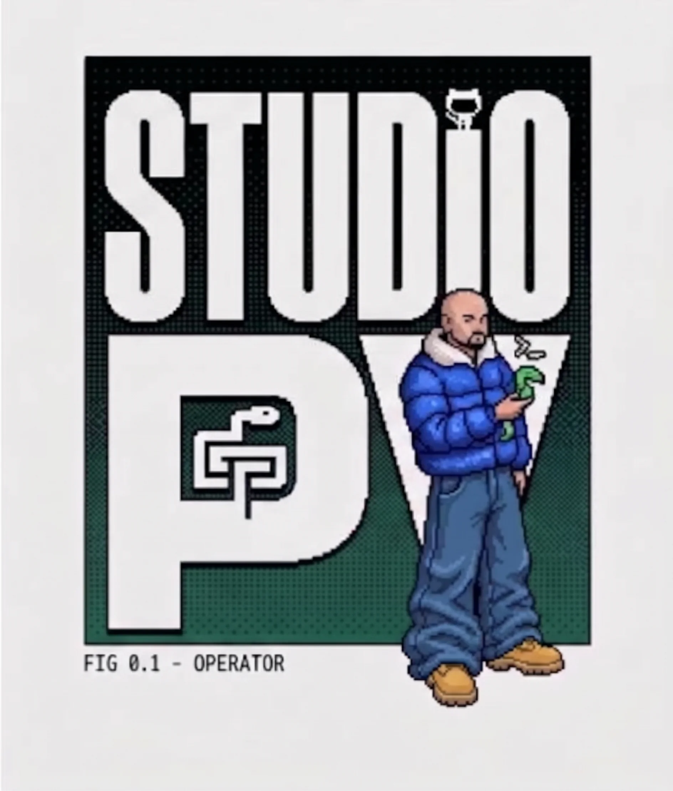

<div align="center">
  
  <br />
  <br />
  <strong>A psychological incident-response curriculum for Python.</strong>
  <br />
  24 modules · 24 weeks · runs entirely in your browser.
</div>

---

## The Thesis: Aqua Shell, Brutalist Core

Studio Py is not a standard video-course platform. It is an **OS Façade**.

The interface treats the user as a system operator fixing broken servers at 3 AM. It blends the rigid, glowing typography of a 1970s CRT terminal (the *Brutalist Core*) with the glossy, physical window chrome of Mac OS X Tiger (the *Aqua Shell*).

Every waypoint is a broken system. Read the traceback. Find the trap. Fix the file. No playgrounds. No excuses.

## Technical Architecture

- **Framework:** SvelteKit 5 (Runes), Server-Side Rendering (SSR)
- **Runtime:** Pyodide (WebAssembly) executing real Python inside a Web Worker
- **3D Engine:** Three.js via Threlte + Rapier Physics (for interactive data structure visualizations)
- **Styling:** Vanilla CSS. No Tailwind. Custom design tokens, 8-bit sprite icons, and macOS Aqua window management.
- **Deployment:** Cloudflare Pages

## Core Features

- **Live Python Terminal:** Editable code runs directly on the landing page and inside every lesson. No backend required.
- **The Reactive Print:** Terminal output updates the halftone density of the poster in real-time.
- **The Living Index:** A stateful dashboard with a cumulative `T+` time tracker and a custom 8-bit snake spine that grows as you complete modules.
- **3D Sandboxes:** Data structures (Stacks, Trees, Queues) are visualized and manipulated through a physics sandbox driven by the Python code you write.
- **Native Window Management:** Draggable macOS-style windows with functional traffic lights (close, minimize to Dock, maximize).

## Local Development

```bash
# Install dependencies
pnpm install

# Start the dev server
pnpm dev

# Run the full verification suite
pnpm run check
pnpm run check:grading
pnpm run build
```

## License

MIT
