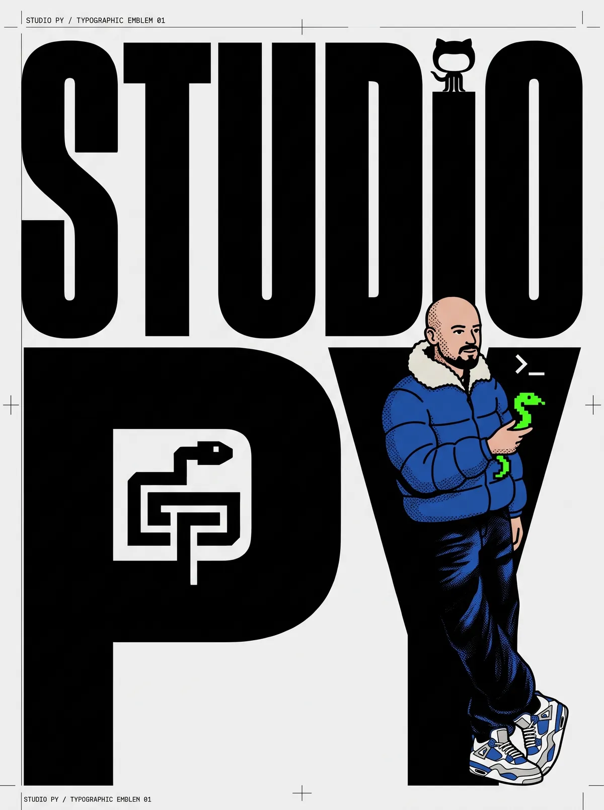

# Studio Py



A brutalist, local-first interactive Python curriculum. Twenty-five modules of runnable Python, 3D physics sandboxes, and zero fluff. Built to survive the 3 AM incident.

## What is this?
Studio Py is a self-paced Python learning platform. It runs entirely in the browser via WebAssembly (Pyodide). The UI is inspired by Swiss editorial design—stark, high-contrast, and fast. 

Instead of just reading about concepts, you run them. The platform includes custom 3D visualizers for specific data structures and algorithms (Stack, Sorting, Data Frames) built with Threlte and Rapier.

## Tech Stack
- **Framework:** SvelteKit 5 (Runes)
- **Python Runtime:** Pyodide (WASM) in a Web Worker
- **3D Engine:** Three.js via Threlte + Rapier Physics
- **Styling:** Vanilla CSS (Brutalist/Editorial)
- **Deployment:** Cloudflare Pages

## Run it locally
```bash
pnpm install
pnpm dev
```
Open `http://localhost:5173`.

## License
MIT
